# Entorno Limpio

Aplicación Web Progresiva (PWA) para registrar incidencias relacionadas con la recolección de residuos sólidos urbanos, incluyendo descripción, fotografía y ubicación.

Permite crear, consultar, editar y eliminar reportes almacenados localmente. Puede funcionar sin conexión después de una primera carga completa.

## Aplicación y repositorio

- [Abrir Entorno Limpio](https://entorno-limpio.vercel.app/)
- [Consultar el código en GitHub](https://github.com/dxvxd-ap/entorno-limpio)

## Caso de uso y alcance

Una persona detecta que el camión recolector no pasó por su calle o que existe basura acumulada. Puede registrar el problema, escribir una referencia del lugar, tomar una fotografía y adjuntar su ubicación actual si corresponde al punto de la incidencia.

Este proyecto es una demostración académica independiente basada en la temática de gestión de residuos e incidencias ciudadanas.

Los reportes se almacenan únicamente en el navegador donde se crean. No se envían a un servidor ni se sincronizan entre dispositivos.

## Funcionalidades

- Crear reportes por tipo de incidencia.
- Registrar descripción y dirección o referencia.
- Capturar una fotografía desde la cámara.
- Adjuntar opcionalmente la ubicación actual.
- Revisar la ubicación mediante OpenStreetMap.
- Consultar el historial de reportes.
- Conservar reportes y fotografías al recargar.
- Editar reportes existentes sin duplicarlos.
- Conservar, reemplazar o quitar fotografía y ubicación al editar.
- Cancelar una edición sin modificar el registro original.
- Eliminar reportes con confirmación previa.
- Cargar la aplicación sin conexión después de la primera visita completa.
- Instalar la PWA en navegadores compatibles.
- Adaptar la interfaz a escritorio y pantallas móviles.

## Tecnologías utilizadas

| Tecnología | Función |
|---|---|
| React | Componentes y renderizado de la interfaz |
| Vite | Desarrollo y compilación |
| CSS | Diseño y adaptación a diferentes pantallas |
| IndexedDB | Persistencia local asíncrona |
| MediaDevices / getUserMedia | Acceso a la cámara |
| Geolocation API | Obtención de coordenadas |
| vite-plugin-pwa y Workbox | Generación del manifiesto, Service Worker y precaché |
| Git y GitHub | Control de versiones y alojamiento del código |
| Vercel | Publicación HTTPS |

Las versiones están registradas en `package.json` y `package-lock.json`.

## Arquitectura

La aplicación utiliza renderizado del lado del cliente (CSR).

Su App Shell está formado por la cabecera, la presentación y las secciones de registro e historial. React actualiza el contenido dinámico de los reportes.

El Service Worker conserva los archivos de la aplicación en Cache Storage. Los datos creados por el usuario se almacenan por separado en IndexedDB.

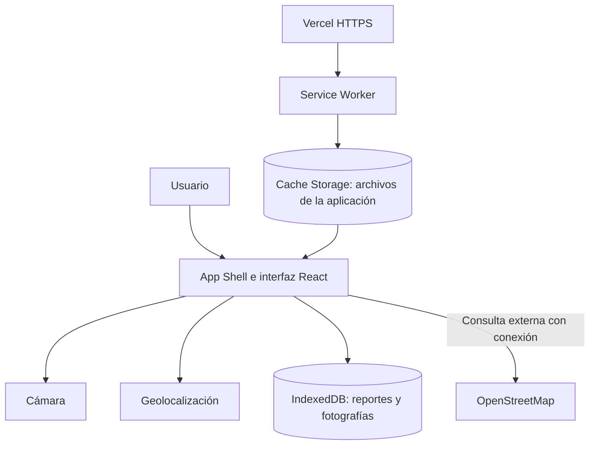

### Organización del proyecto

```text
entorno-limpio/
├── docs/
│   └── capturas/
├── public/
│   └── icons/
├── src/
│   ├── App.jsx
│   ├── App.css
│   ├── Camara.jsx
│   ├── db.js
│   ├── index.css
│   └── main.jsx
├── index.html
├── package.json
├── package-lock.json
├── vite.config.js
└── README.md
```

### Responsabilidades principales

- `App.jsx`: formulario, historial, edición, eliminación y geolocalización.
- `Camara.jsx`: solicitud de cámara, vista previa y captura.
- `db.js`: apertura de IndexedDB y operaciones de guardado, consulta y eliminación.
- `App.css` e `index.css`: presentación y diseño adaptable.
- `vite.config.js`: configuración del manifiesto y Service Worker.
- `public/icons/`: iconos PNG de instalación.

## Manifiesto e instalación

El manifiesto se genera como `manifest.json` durante la compilación.

Incluye:

- Nombre y nombre corto de la aplicación.
- Descripción e idioma.
- Identificador, ruta de inicio y alcance.
- Modo de visualización `standalone`.
- Colores de tema y fondo.
- Iconos PNG de 192 × 192 y 512 × 512 píxeles.
- Icono adaptable de 512 × 512 píxeles con propósito `maskable`.

Estos metadatos permiten que los navegadores compatibles ofrezcan la instalación y utilicen la identidad visual de la aplicación.

La pantalla de inicio y la experiencia de instalación dependen del navegador y del sistema operativo. En Android se comprobó la pantalla de inicio nativa con el icono EL y el fondo de la aplicación antes de mostrar la interfaz.

## Service Worker y caché

La compilación de producción genera `sw.js`, su registro y los archivos auxiliares de Workbox.

El Service Worker administra el precaché de los archivos generados. Esto permite recuperar la interfaz y sus recursos después de la primera carga, aunque no haya conexión.

La configuración incluye:

- Precaché de HTML, JavaScript, CSS e imágenes incluidas en la compilación.
- Recuperación de `index.html` para navegación.
- Limpieza de precachés obsoletos.
- `clientsClaim` para tomar el control de los clientes al activarse.
- Comportamiento de actualización configurado como `prompt`.

Esta versión no incluye una interfaz personalizada para avisar y aplicar actualizaciones.

No existe una API remota de reportes. La información dinámica se consulta directamente desde IndexedDB, en lugar de almacenarse en un caché de respuestas de servidor.

## Persistencia con IndexedDB

La base de datos se llama `entorno-limpio` y contiene el almacén `reportes`, cuya clave es `id`.

Cada reporte conserva:

| Campo | Contenido |
|---|---|
| `id` | Identificador único |
| `tipo` | Categoría del problema |
| `descripcion` | Descripción de la incidencia |
| `direccion` | Dirección o referencia |
| `creadoEn` | Marca de tiempo de creación |
| `fecha` | Fecha de creación mostrada al usuario |
| `estado` | Estado de registro local |
| `ubicacion` | Coordenadas y precisión, si se adjuntan |
| `foto` | Imagen JPEG, si se captura |
| `actualizadoEn` | Marca de tiempo de la última edición, cuando existe |

Las operaciones son asíncronas:

- **Guardar y editar:** se utiliza `put()`. Al conservar el mismo identificador, se actualiza el registro existente.
- **Consultar:** se utiliza `getAll()` y se ordenan los reportes por fecha de creación.
- **Eliminar:** se utiliza `delete()` con el identificador del reporte.

La interfaz confirma las operaciones después de completar sus transacciones. Si falla el guardado, los datos permanecen en el formulario para permitir otro intento.

Los reportes pertenecen al navegador, perfil y origen donde se crearon. Localhost y el dominio publicado tienen almacenamientos separados. Borrar los datos del sitio puede eliminar los registros.

## Integración de APIs del dispositivo

### Cámara

El acceso se solicita cuando el usuario presiona “Abrir cámara”.

- Se solicita video sin micrófono.
- Se muestra una vista previa.
- La captura se convierte en una imagen JPEG.
- La imagen se adjunta al guardar el reporte.
- Las pistas de video se detienen al capturar, cancelar o desmontar el componente.
- Se muestran mensajes ante permisos rechazados, ausencia de cámara o problemas de acceso.

### Geolocalización

El acceso se solicita al presionar “Usar mi ubicación actual”.

- Obtiene latitud, longitud y precisión aproximada.
- Permite revisar el punto mediante un enlace a OpenStreetMap.
- Permite quitar la ubicación antes de guardar.
- Maneja rechazo de permisos, falta de disponibilidad y tiempo de espera.
- Conserva la opción de escribir una dirección.

La ubicación actual debe adjuntarse únicamente cuando corresponda al lugar del problema.

Al abrir el enlace externo, las coordenadas se incluyen en la dirección enviada a OpenStreetMap para mostrar el punto.

## Funcionamiento sin conexión

Después de una primera carga completa y de la activación del Service Worker, es posible:

- Abrir y recargar la aplicación.
- Crear y consultar reportes locales.
- Editar y eliminar registros locales.
- Visualizar fotografías almacenadas.
- Capturar fotografías si el dispositivo y los permisos lo permiten.

La obtención de una nueva ubicación depende del dispositivo y de su proveedor de posicionamiento; no se garantiza sin conexión.

Se necesita internet para:

- La primera descarga de la aplicación.
- Descargar nuevas versiones.
- Abrir el mapa externo de OpenStreetMap.

Esta versión no incluye envío ni sincronización de reportes al recuperar la conexión.

## Ejecutar el proyecto

### Requisitos

- Node.js compatible con las versiones utilizadas de Vite y sus complementos.
- npm.
- Git.
- Navegador actualizado.

### Descargar e instalar

```bash
git clone https://github.com/dxvxd-ap/entorno-limpio.git
cd entorno-limpio
npm ci
```

### Desarrollo

```bash
npm run dev
```

Abrir la dirección indicada en la terminal.

### Compilar

```bash
npm run build
```

Los archivos de producción se generan en `dist/`.

### Probar la compilación

```bash
npm run preview
```

Abrir la dirección indicada, normalmente `http://localhost:4173/`.

La validación del Service Worker se realiza sobre la versión compilada o publicada.

## Instrucciones de uso

### Crear un reporte

1. Seleccionar el tipo de incidencia.
2. Escribir la descripción.
3. Agregar la dirección o referencia.
4. Capturar una fotografía, si se desea.
5. Obtener y revisar la ubicación, si corresponde.
6. Presionar “Crear reporte”.
7. Consultar el registro en “Mis reportes”.

**Credenciales de prueba:** no se requiere registro, cuenta ni contraseña.

Para las pruebas se recomienda utilizar direcciones ficticias y fotografías sin información personal.

### Editar un reporte

1. Localizar el reporte en “Mis reportes”.
2. Presionar “Editar” y confirmar la apertura.
3. Modificar los datos necesarios.
4. Presionar “Guardar cambios”.

La fotografía y ubicación existentes se conservan, salvo que se reemplacen o quiten.

La actualización mantiene el identificador y la fecha de creación, registra la última edición y actualiza el registro en IndexedDB sin duplicarlo.

“Cancelar edición” permite descartar los cambios del formulario, previa confirmación, sin modificar el reporte almacenado.

### Eliminar un reporte

1. Presionar “Eliminar” en el reporte correspondiente.
2. Confirmar la eliminación en el diálogo.

La eliminación borra el registro completo, incluida su fotografía, de IndexedDB.

El historial y el contador se actualizan cuando termina correctamente la transacción. Si el reporte estaba abierto para edición, se limpia el formulario.

Si se cancela la confirmación, el reporte permanece intacto. La eliminación confirmada no se puede deshacer.

## Instalación de la PWA

1. Abrir [Entorno Limpio](https://entorno-limpio.vercel.app/) con conexión.
2. Seleccionar la opción de instalación del navegador.
3. Confirmar la instalación.
4. Abrir la aplicación desde el sistema operativo.

La instalación desde el dominio publicado se comprobó en Brave para Windows y en Chrome para Android. En Android se documentaron el diálogo de instalación, la confirmación del sistema y la apertura de la aplicación instalada. La disponibilidad de esta función depende del navegador y del sistema operativo.

## Pruebas realizadas

| Prueba | Resultado observado |
|---|---|
| Crear un reporte | Aparece en el historial |
| Recargar después de guardar | El reporte se conserva |
| Capturar una fotografía | Se adjunta al reporte |
| Recargar con fotografía guardada | La imagen se conserva |
| Obtener ubicación | Se genera el enlace al mapa |
| Recargar la versión pública en modo Offline | La aplicación y el reporte siguen disponibles |
| Instalar desde el dominio de producción | Abre en una ventana independiente |
| Consultar IndexedDB | Se observa el registro almacenado |
| Editar un reporte | Se actualiza sin aumentar el contador |
| Eliminar un reporte | Se comprobó el funcionamiento de la eliminación |
| Visualizar en celular | Se observa la adaptación visual de la cabecera y presentación |
| Pantalla de inicio en Android | Se observa el icono EL antes de cargar la interfaz |
| Actualizar a versión 1.1 | El worker nuevo se activa manualmente con `skipWaiting` y conserva los datos |
| Recargar versión 1.1 en Offline | Se conservan la interfaz, el reporte editado y su fotografía |
| Instalar en Chrome para Android | El sistema confirma la instalación |
| Abrir la PWA instalada en Android | Abre sin la barra de direcciones del navegador |

Las pruebas de publicación, instalación y carga offline se realizaron sobre el dominio de Vercel. Tras publicar la versión 1.1 se observó el reporte editado, con su fotografía y fecha de última edición, conservado después de activar la actualización y recargar sin conexión. La eliminación debe validarse en producción con un reporte desechable antes de considerarla comprobada en ese entorno.

Las pruebas funcionales principales se realizaron en escritorio. Las capturas móviles documentan la parte visible de la interfaz y la instalación en Android; no certifican todas las funciones del teléfono. La pantalla de inicio (splash screen) se comprobó por separado al abrir la aplicación instalada.

### Reproducir la prueba offline

1. Abrir la aplicación con conexión.
2. Esperar la carga inicial y recargar una vez.
3. Crear un reporte.
4. Abrir las herramientas de desarrollo.
5. En `Network`, seleccionar `Offline`.
6. Recargar normalmente.
7. Comprobar la interfaz y los reportes almacenados.
8. Crear otro reporte y recargar para comprobar su persistencia.
9. Probar la edición y eliminación de un reporte desechable.
10. Restaurar `No throttling`.

### Comprobaciones de edición y eliminación

- Guardar una edición sin aumentar la cantidad de reportes.
- Recargar y verificar que los cambios se conserven.
- Cancelar una edición y comprobar que el registro original no cambie.
- Cancelar una eliminación y comprobar que el reporte permanezca.
- Confirmar la eliminación de un reporte de prueba.
- Recargar y comprobar que el reporte siga eliminado.
- Verificar que los demás reportes permanezcan intactos.

## Validación de actualización a la versión 1.1

Se publicó una modificación visible en el pie de página para identificar la versión 1.1 y comprobar la actualización del Service Worker.

1. Se confirmó en Vercel la publicación de producción del commit `13d8175`.
2. Desde las herramientas de desarrollo se solicitó la comprobación con `Update`.
3. El worker anterior permaneció activo mientras el nuevo quedó en `waiting to activate`.
4. Se activó manualmente el worker nuevo con `skipWaiting` desde las herramientas de desarrollo.
5. Después de recargar, el worker nuevo apareció activado y el pie mostró “Versión 1.1”.
6. El reporte y la fotografía se conservaron en IndexedDB.
7. Con `Offline` seleccionado, se recargó y se comprobó que la versión 1.1 y el reporte editado siguieran disponibles.

La prueba demuestra descarga, espera, activación manual y carga offline de la nueva versión conservando datos. No demuestra la activación automática al cerrar todos los clientes ni un aviso de actualización dentro de la aplicación.

## Validación de instalación y pantalla de inicio en Android

Se comprobó la instalación desde Chrome, la confirmación del sistema, la apertura sin barra de direcciones y la presencia de Entorno Limpio en la información de aplicaciones de Android.

Al abrir la aplicación instalada se observó la pantalla de inicio nativa con el icono EL sobre el fondo de la aplicación. No se agregó una pantalla artificial dentro de React para simular este comportamiento.

## Evidencias

Las imágenes se encuentran en `docs/capturas/`.

### Vista de escritorio

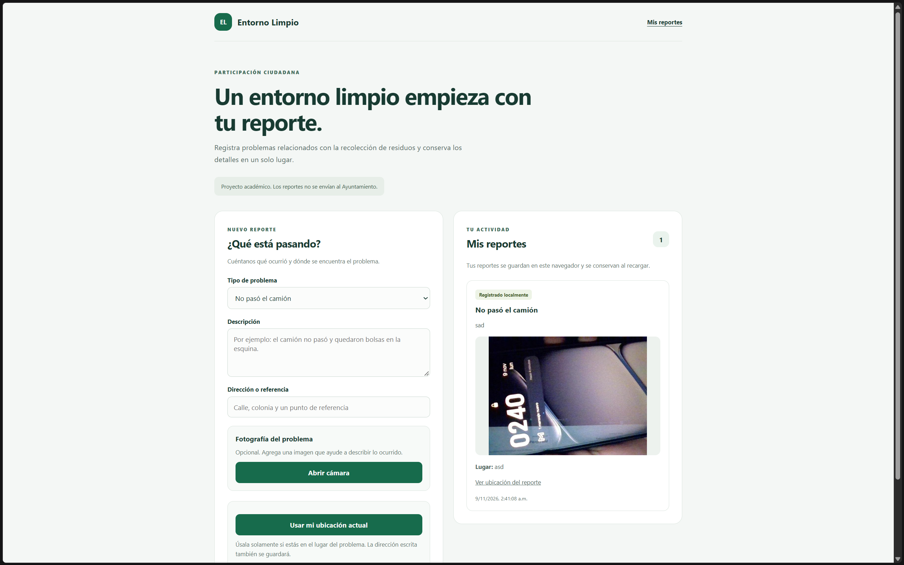

### Vista móvil

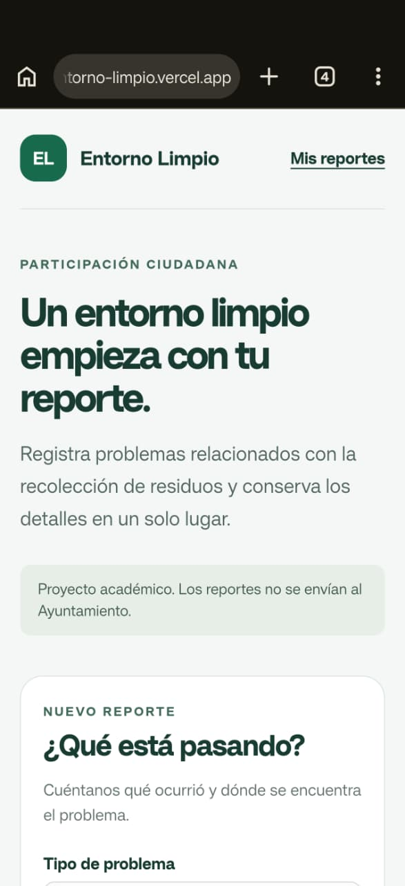

### Persistencia en IndexedDB

Las coordenadas se ocultaron para evitar publicar la ubicación precisa utilizada durante las pruebas.

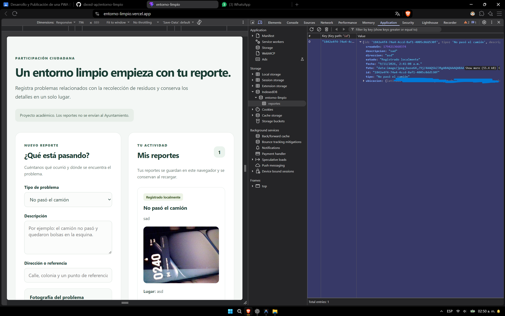

### Funcionamiento offline en producción

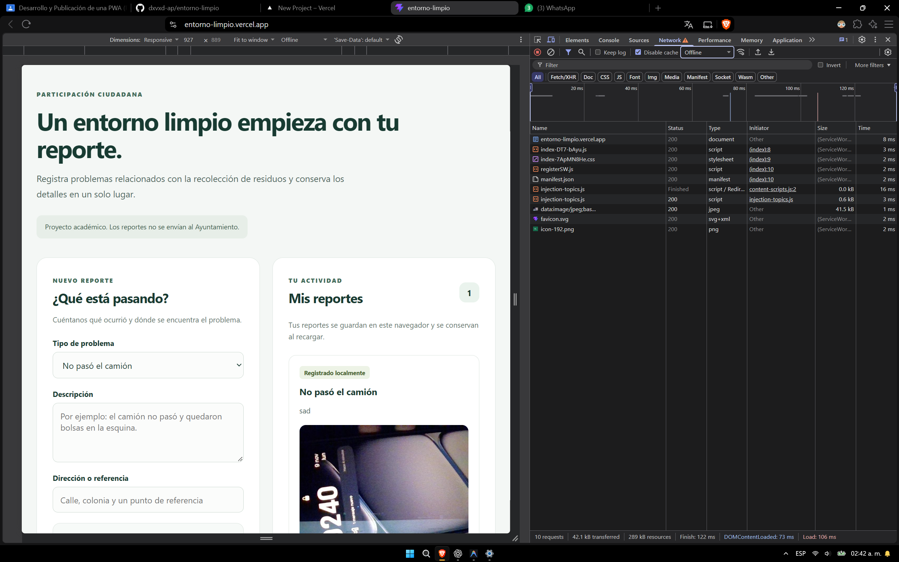

### Instalación desde el dominio público

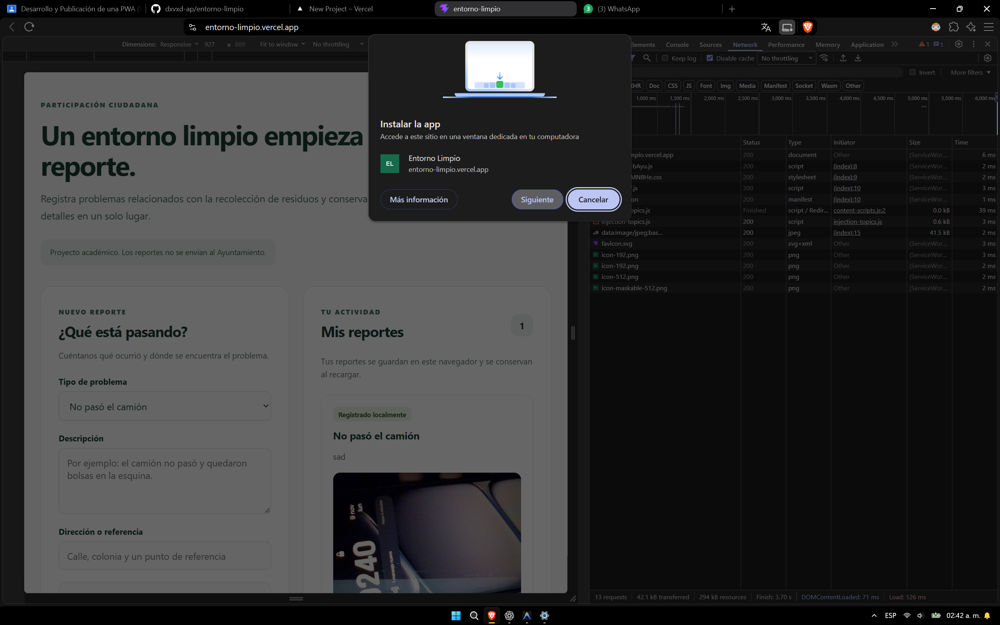

### Aplicación instalada

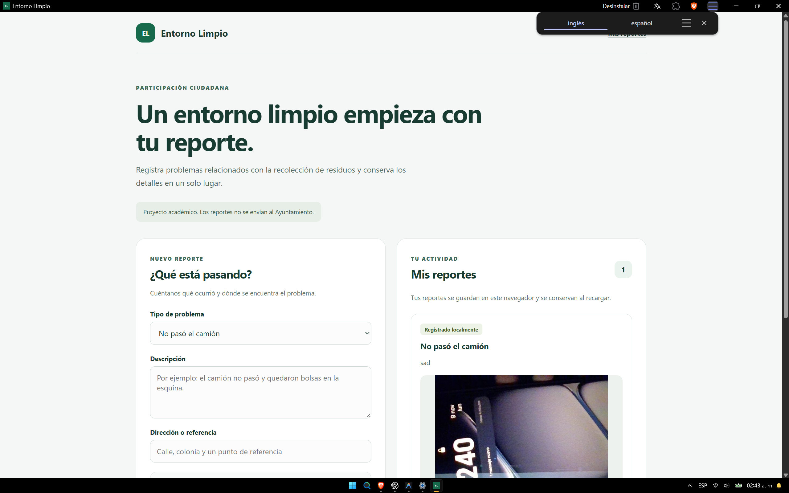

### Instalación en Android

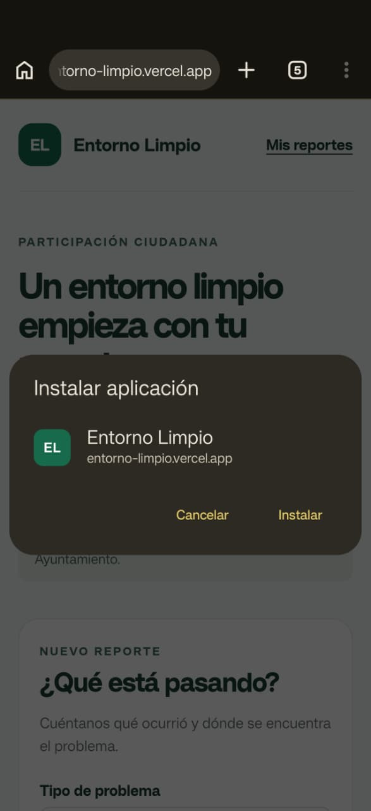

### Confirmación de instalación en Android

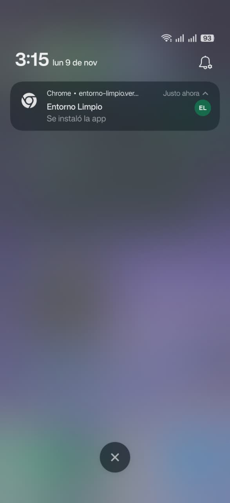

### Aplicación instalada en Android

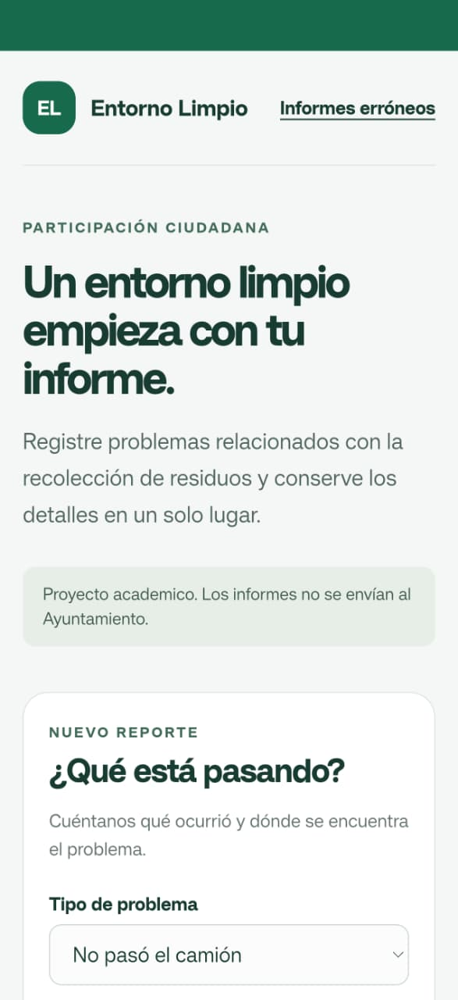

### Pantalla de inicio móvil


### Información de la aplicación en Android

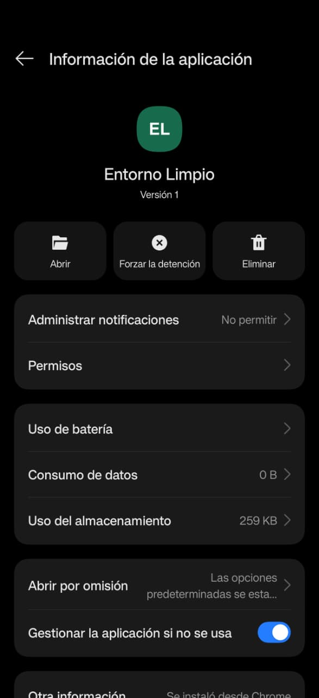

### Service Worker actualizado

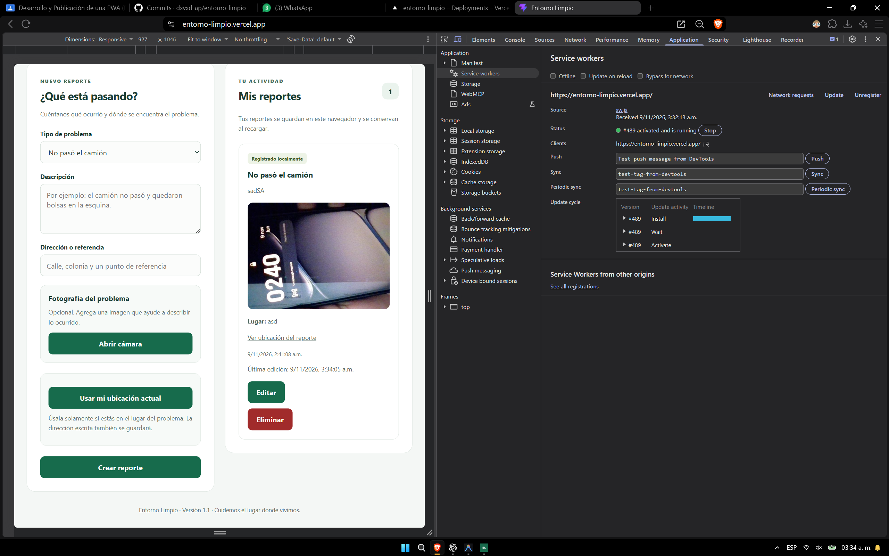

### Versión 1.1 sin conexión

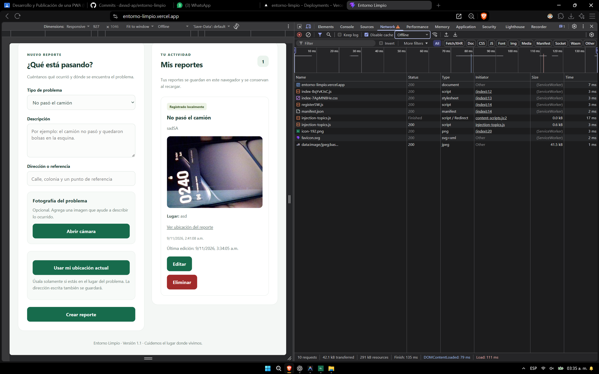

## Publicación

La aplicación está alojada en Vercel y disponible mediante HTTPS:

https://entorno-limpio.vercel.app/

Configuración utilizada:

| Opción | Valor |
|---|---|
| Repositorio | `dxvxd-ap/entorno-limpio` |
| Rama | `main` |
| Framework | Vite |
| Comando de compilación | `vite build` |
| Directorio de salida | `dist` |

Las funciones actuales no requieren variables de entorno.

Las modificaciones locales deben guardarse en Git y subirse al repositorio para que Vercel genere una nueva publicación.

## Control de versiones

El proyecto utiliza Git y un repositorio público en GitHub.

La implementación inicial se incorporó en un primer commit que reúne la interfaz, IndexedDB, cámara, geolocalización y configuración PWA.

Esto limita la evidencia del avance incremental: el historial inicial no registra por separado cada etapa de desarrollo.

La documentación y las mejoras posteriores, como edición y eliminación, se registran mediante commits correspondientes a cambios reales conforme se realizan.

## Revisión de dependencias

Durante la revisión:

- `npm audit --omit=dev` informó 0 vulnerabilidades conocidas en las dependencias de producción.
- `npm audit` informó 9 avisos en herramientas de desarrollo y compilación: 2 bajos y 7 moderados.
- `npm audit fix` no resolvió los avisos dentro de las versiones permitidas.
- No se aplicó `npm audit fix --force`, porque proponía cambios de versiones mayores.
- `npm outdated` no mostró actualizaciones disponibles para las dependencias directas revisadas.

Los avisos de desarrollo siguen pendientes. Los resultados pueden cambiar con nuevas versiones o actualizaciones de la base de avisos de npm.

## Limitaciones y mejoras pendientes

- No hay envío de reportes a un servicio externo.
- No hay sincronización entre dispositivos.
- No existe panel administrativo ni seguimiento de atención de incidencias.
- “Registrado localmente” indica guardado en el navegador.
- El mapa externo requiere internet.
- La eliminación es definitiva y no cuenta con papelera.
- El almacenamiento depende del espacio y las políticas del navegador.
- Faltan pruebas funcionales completas en móviles y otros navegadores.
- Falta una interfaz personalizada de actualización de la PWA.
- Puede incorporarse la exportación y el respaldo de reportes.