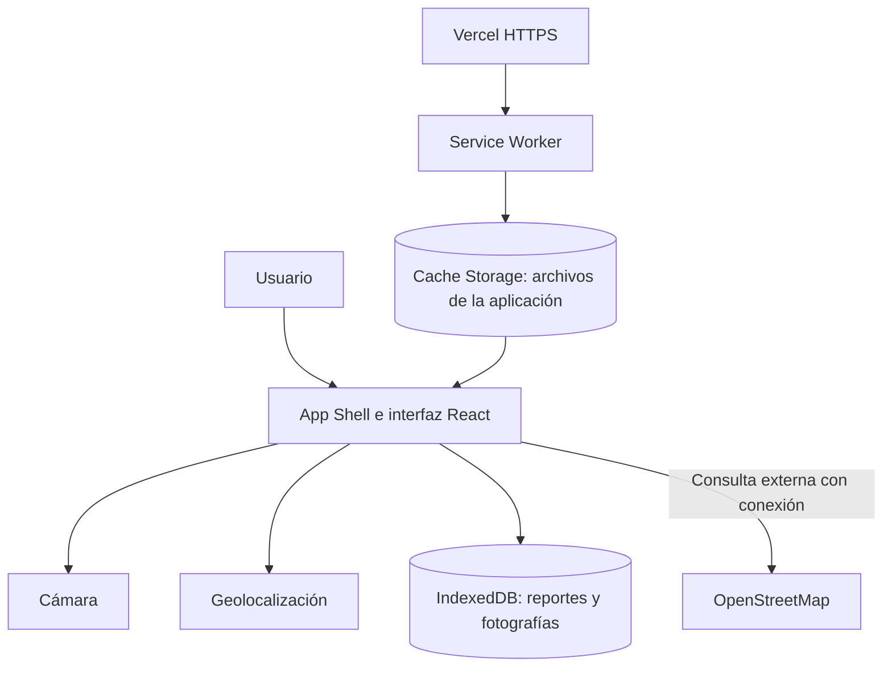

# Entorno Limpio

Aplicación Web Progresiva (PWA) para registrar incidencias relacionadas con la recolección de residuos sólidos urbanos, incluyendo descripción, fotografía y ubicación.

Permite conservar y consultar reportes localmente, incluso sin conexión después de la primera carga.

## Aplicación y repositorio

- [Abrir Entorno Limpio](https://entorno-limpio.vercel.app/)
- [Consultar el código en GitHub](https://github.com/dxvxd-ap/entorno-limpio)

## Caso de uso y alcance

Una persona detecta que el camión recolector no pasó por su calle o que existe basura acumulada. Puede registrar el problema, escribir una referencia del lugar, tomar una fotografía y adjuntar su ubicación actual si corresponde al punto de la incidencia.

Este proyecto es una demostración académica independiente, basada en la temática de gestión de residuos e incidencias ciudadanas.

Los reportes se almacenan únicamente en el navegador donde se crean. No se envían a un servidor ni se sincronizan entre dispositivos.

## Funcionalidades

- Crear reportes por tipo de incidencia.
- Registrar descripción y dirección o referencia.
- Capturar una fotografía desde la cámara.
- Adjuntar opcionalmente la ubicación actual.
- Revisar la ubicación mediante OpenStreetMap.
- Consultar el historial de reportes.
- Conservar reportes y fotografías al recargar.
- Cargar la aplicación sin conexión después de la primera visita completa.
- Instalar la PWA en navegadores compatibles.
- Adaptar la interfaz a escritorio y pantallas móviles.

## Tecnologías utilizadas

| Tecnología | Función |
|---|---|
| React | Componentes y renderizado de la interfaz |
| Vite | Servidor de desarrollo y compilación |
| CSS | Diseño y adaptación a diferentes pantallas |
| IndexedDB | Persistencia local asíncrona |
| MediaDevices / getUserMedia | Acceso a la cámara |
| Geolocation API | Obtención de coordenadas |
| vite-plugin-pwa y Workbox | Generación del manifiesto, Service Worker y precaché |
| Git y GitHub | Control de versiones y alojamiento del código |
| Vercel | Publicación HTTPS |

Las versiones del proyecto están registradas en `package.json` y `package-lock.json`.

## Arquitectura

La aplicación utiliza renderizado del lado del cliente (CSR).

Su App Shell está formado por la cabecera, la presentación y las secciones de registro e historial. React actualiza los reportes sin recargar toda la página.

El Service Worker conserva los archivos de la aplicación en Cache Storage. Los datos creados por el usuario se almacenan por separado en IndexedDB.



### Organización del proyecto

```text
entorno-limpio/
├── docs/
│   └── capturas/
├── public/
│   └── icons/
├── src/
│   ├── App.jsx
│   ├── App.css
│   ├── Camara.jsx
│   ├── db.js
│   ├── index.css
│   └── main.jsx
├── index.html
├── package.json
├── package-lock.json
├── vite.config.js
└── README.md
```

### Responsabilidades principales

- `App.jsx`: formulario, historial, geolocalización y coordinación del guardado.
- `Camara.jsx`: solicitud de cámara, vista previa y captura.
- `db.js`: apertura de IndexedDB, guardado y consulta de reportes.
- `App.css` e `index.css`: presentación y diseño adaptable.
- `vite.config.js`: configuración del manifiesto y Service Worker.
- `public/icons/`: iconos PNG de instalación.

## Manifiesto e instalación

El manifiesto se genera como `manifest.json` durante la compilación.

Incluye:

- Nombre y nombre corto de la aplicación.
- Descripción e idioma.
- Identificador, ruta de inicio y alcance.
- Modo de visualización `standalone`.
- Colores de tema y fondo.
- Iconos PNG de 192 × 192 y 512 × 512 píxeles.
- Icono adaptable de 512 × 512 píxeles con propósito `maskable`.

Estos metadatos permiten que los navegadores compatibles ofrezcan la instalación y utilicen la identidad visual de la aplicación. La pantalla de inicio y la experiencia de instalación dependen del navegador y del sistema operativo.

## Service Worker y caché

La compilación de producción genera `sw.js`, su registro y los archivos auxiliares de Workbox.

El Service Worker administra el precaché de los archivos generados de la aplicación. Esto permite recuperar la interfaz y sus recursos después de la primera carga, aunque no haya conexión.

La configuración incluye:

- Precaché de HTML, JavaScript, CSS e imágenes incluidas en la compilación.
- Recuperación de `index.html` para navegación.
- Limpieza de precachés obsoletos.
- `clientsClaim` para tomar el control de los clientes al activarse.
- Comportamiento de actualización configurado como `prompt`.

Esta versión no incluye una interfaz personalizada para avisar y aplicar actualizaciones.

No existe una API remota de reportes. Por ello, la información dinámica se consulta directamente desde IndexedDB, en lugar de almacenarse en un caché de respuestas de servidor.

## Persistencia con IndexedDB

La base de datos se llama `entorno-limpio` y contiene el almacén `reportes`, cuya clave es `id`.

Cada reporte conserva:

| Campo | Contenido |
|---|---|
| `id` | Identificador único |
| `tipo` | Categoría del problema |
| `descripcion` | Descripción de la incidencia |
| `direccion` | Dirección o referencia |
| `creadoEn` | Marca de tiempo para ordenar los registros |
| `fecha` | Fecha mostrada al usuario |
| `estado` | Registro local del reporte |
| `ubicacion` | Coordenadas y precisión, si se adjuntan |
| `foto` | Imagen JPEG, si se captura |

El guardado y la consulta son asíncronos. La interfaz confirma el guardado después de completar la transacción. Si ocurre un error, conserva los datos del formulario para permitir otro intento.

Los reportes pertenecen al navegador, perfil y origen donde fueron creados. Localhost y el dominio publicado tienen almacenamientos separados. Borrar los datos del sitio puede eliminar los registros.

## Integración de APIs del dispositivo

### Cámara

El acceso se solicita cuando el usuario presiona “Abrir cámara”.

- Se solicita video sin micrófono.
- Se muestra una vista previa.
- La captura se convierte en una imagen JPEG.
- La imagen se adjunta al guardar el reporte.
- Las pistas de video se detienen al capturar, cancelar o desmontar el componente.
- Se muestran mensajes ante permisos rechazados, ausencia de cámara o problemas de acceso.

### Geolocalización

El acceso se solicita al presionar “Usar mi ubicación actual”.

- Obtiene latitud, longitud y precisión aproximada.
- Permite revisar el punto mediante un enlace a OpenStreetMap.
- Permite quitar la ubicación antes de guardar.
- Maneja rechazo de permisos, falta de disponibilidad y tiempo de espera.
- Conserva la opción de escribir una dirección.

La ubicación actual debe adjuntarse únicamente cuando corresponda al lugar del problema.

Al abrir el enlace externo, las coordenadas se incluyen en la dirección enviada a OpenStreetMap para mostrar el punto.

## Funcionamiento sin conexión

Después de una primera carga completa y de la activación del Service Worker, es posible:

- Abrir y recargar la aplicación.
- Crear reportes.
- Consultar los registros guardados.
- Visualizar las fotografías almacenadas.
- Capturar fotografías si el dispositivo y los permisos lo permiten.

La obtención de una nueva ubicación depende del dispositivo y de su proveedor de posicionamiento; no se garantiza sin conexión.

Se necesita internet para:

- La primera descarga de la aplicación.
- Descargar nuevas versiones.
- Abrir el mapa externo de OpenStreetMap.

Los reportes se guardan localmente. Esta versión no incluye envío ni sincronización al recuperar la conexión.

## Ejecutar el proyecto

### Requisitos

- Node.js compatible con las versiones utilizadas de Vite y sus complementos.
- npm.
- Git.
- Navegador actualizado.

### Descargar e instalar

```bash
git clone https://github.com/dxvxd-ap/entorno-limpio.git
cd entorno-limpio
npm ci
```

### Desarrollo

```bash
npm run dev
```

Abrir la dirección indicada en la terminal.

### Compilar

```bash
npm run build
```

Los archivos de producción se generan en `dist/`.

### Probar la compilación

```bash
npm run preview
```

Abrir la dirección indicada, normalmente `http://localhost:4173/`.

La validación del Service Worker se realiza sobre la versión compilada o publicada.

## Instrucciones de uso

1. Seleccionar el tipo de incidencia.
2. Escribir la descripción.
3. Agregar la dirección o referencia.
4. Capturar una fotografía, si se desea.
5. Obtener y revisar la ubicación, si corresponde.
6. Presionar “Crear reporte”.
7. Consultar el registro en “Mis reportes”.

**Credenciales de prueba:** no se requiere registro, cuenta ni contraseña.

Para realizar pruebas se recomienda utilizar direcciones ficticias y fotografías sin información personal.

## Instalación de la PWA

1. Abrir [Entorno Limpio](https://entorno-limpio.vercel.app/) con conexión.
2. Seleccionar la opción de instalación del navegador.
3. Confirmar la instalación.
4. Abrir la aplicación desde el sistema operativo.

La instalación se comprobó en Brave para Windows desde el dominio publicado.

## Pruebas realizadas

| Prueba | Resultado observado |
|---|---|
| Crear un reporte | Aparece en el historial |
| Recargar después de guardar | El reporte se conserva |
| Capturar una fotografía | Se adjunta al reporte |
| Recargar con fotografía guardada | La imagen se conserva |
| Obtener ubicación | Se genera el enlace al mapa |
| Recargar la versión pública en modo Offline | La aplicación y el reporte siguen disponibles |
| Instalar desde el dominio de producción | Abre en una ventana independiente |
| Consultar IndexedDB | Se observa el registro almacenado |
| Visualizar en celular | Se observa la adaptación visual de la cabecera y presentación |

Las pruebas funcionales principales se realizaron en Brave para escritorio. La captura móvil documenta la parte visible de la interfaz; no certifica todas las funciones del teléfono.

### Reproducir la prueba offline

1. Abrir la aplicación con conexión.
2. Esperar la carga inicial y recargar una vez.
3. Crear un reporte.
4. Abrir las herramientas de desarrollo.
5. En `Network`, seleccionar `Offline`.
6. Recargar normalmente.
7. Comprobar la interfaz y los reportes almacenados.
8. Crear otro reporte y recargar para comprobar su persistencia.
9. Restaurar `No throttling`.

## Evidencias

Las imágenes se encuentran en `docs/capturas/`.

### Vista de escritorio


### Vista móvil


### Persistencia en IndexedDB

Las coordenadas se ocultaron en la evidencia para evitar publicar la ubicación precisa utilizada durante las pruebas.


### Funcionamiento offline en producción


### Instalación desde el dominio público


### Aplicación instalada


## Publicación

La aplicación está alojada en Vercel y disponible mediante HTTPS:

https://entorno-limpio.vercel.app/

Configuración utilizada:

| Opción | Valor |
|---|---|
| Repositorio | `dxvxd-ap/entorno-limpio` |
| Rama | `main` |
| Framework | Vite |
| Comando de compilación | `vite build` |
| Directorio de salida | `dist` |

Las funciones actuales no requieren variables de entorno.

## Control de versiones

El proyecto utiliza Git y un repositorio público en GitHub.

La implementación funcional se incorporó en un primer commit que reúne la interfaz, IndexedDB, cámara, geolocalización y configuración PWA.

Esto limita la evidencia del avance incremental: el historial inicial no registra por separado cada etapa de desarrollo. Los cambios posteriores de documentación y mantenimiento se registrarán conforme se realicen.

## Revisión de dependencias

Durante la revisión:

- `npm audit --omit=dev` informó 0 vulnerabilidades conocidas en las dependencias de producción.
- `npm audit` informó 9 avisos en herramientas de desarrollo y compilación: 2 bajos y 7 moderados.
- `npm audit fix` no resolvió los avisos dentro de las versiones permitidas.
- No se aplicó `npm audit fix --force`, porque proponía cambios de versiones mayores.
- `npm outdated` no mostró actualizaciones disponibles para las dependencias directas revisadas.

Los avisos de desarrollo siguen pendientes. Los resultados pueden cambiar con nuevas versiones o actualizaciones de la base de avisos de npm.

## Limitaciones y mejoras pendientes

- No hay envío de reportes a un servicio externo.
- No hay sincronización entre dispositivos.
- No existe panel administrativo ni seguimiento de atención de incidencias.
- “Registrado localmente” indica guardado en el navegador, no recepción por una autoridad.
- El mapa externo requiere internet.
- El almacenamiento depende del espacio y las políticas del navegador.
- Faltan pruebas funcionales completas en móviles y otros navegadores.
- Falta una interfaz personalizada de actualización de la PWA.
- Pueden incorporarse edición, eliminación y exportación de reportes.